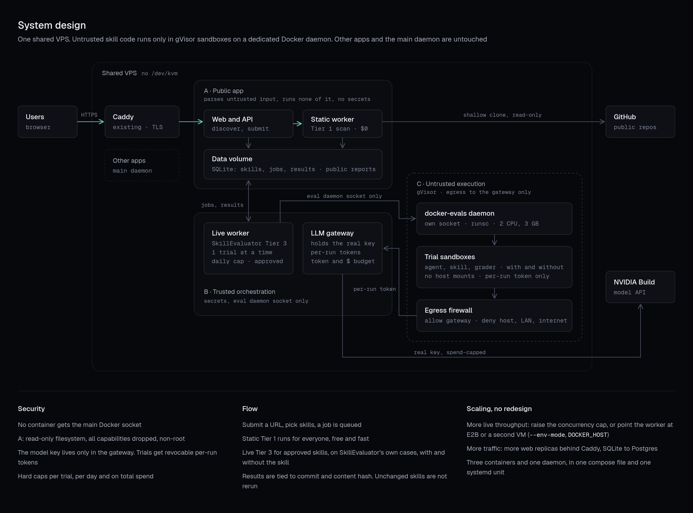

# Architecture

The source of the diagram is `design/system.html`. Only the static path is implemented today. Live Tier 3 is designed
but blocked on a model key and the sandbox install.

## Flow
1. **Submit:** a repository URL → `pipeline/discover.py` lists the `SKILL.md` folders → the submitter picks which
   ones → jobs are queued. Rate, size and queue limits apply (see `docs/METHODOLOGY.md`, Safety).
2. **Static Tier 1** runs for every skill. It is free, takes seconds to two minutes, and executes no skill code
   (`pipeline/evaluate.py`). For now it runs as a subprocess in the zone A container. Moving it to zone B's
   pinned, network-less image is planned (ADR-0002 amendment, #65).
3. **Live Tier 3** (designed, not running) runs only for approved skills, with and without the skill, on
   SkillEvaluator's own cases for that skill (`pipeline/tier3.py`, ADR-0006).
4. **Results** are stored with the commit, folder digest and evaluator version. Unchanged skills are not rerun.
   The leaderboard ranks by ADR-0001.

## Decisions
- Ranking and statuses: [ADR-0001](adr/0001-rank-on-structure-keep-signals-apart.md)
- Trust zones: [ADR-0002](adr/0002-three-trust-zones.md)
- Eval sandbox: [ADR-0003](adr/0003-gvisor-eval-daemon.md)
- Secrets: [ADR-0004](adr/0004-secrets-live-on-the-host.md)
- Process: [ADR-0005](adr/0005-development-process.md)

## Limits
Hard caps apply per trial, per day and on total spend. When a cap is reached, the queue pauses rather than
overspending.

## Scaling without redesign
- More live throughput: raise the concurrency cap, or point the worker at E2B or a second VM (`--env-mode` /
  `DOCKER_HOST`).
- More traffic: add web replicas behind Caddy, and move from SQLite to Postgres.

## Open items
- Host specs (`nproc`, `free -g`, `uname -r`) and the name of Caddy's Docker network.
- A model key for live runs.
